# Rubato Waveform Generator

Rubato Waveform Generator is a free, open-source desktop audio waveform generator. It turns an audio file into an animated, audio-reactive waveform video with a transparent background (ProRes 4444 with alpha, in a MOV) that you place above your footage in a video editor.

[](LICENSE)
[](https://github.com/VukoP/rubato-waveform-generator/actions/workflows/ci.yml)

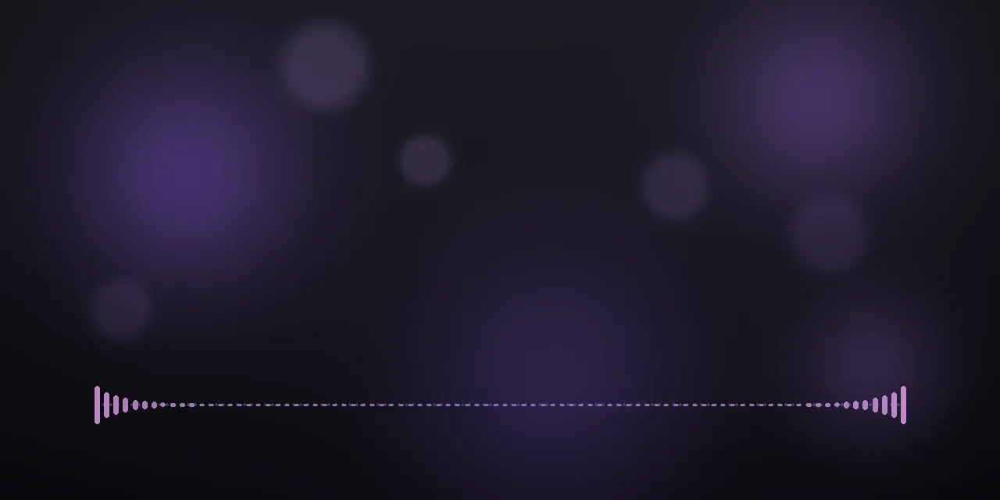

Podcasters, video editors and musicians often want a waveform that moves with the sound, sits on top of a video or a still image, and stays transparent. This app draws the real shape of your audio (peaks and loudness analyzed every 5 ms) and exports a clip with true alpha. Everything runs on your computer: no account, no upload, no telemetry.

## Why this exists

I wanted an animated waveform over a video in DaVinci Resolve. Building one inside Resolve is complicated, so I searched Google for an open-source repository that would do it, and I could not find one.

So I made this app. It renders a ready-made MOV with a transparent background. You drop the file into your DaVinci Resolve project and place it on a track above your footage.

## Download and install

You don't need Python or any programming tools to use the app. Install FFmpeg once, download the app and open it.

FFmpeg is the free tool the app uses to read audio and write the MOV. It is not bundled, for licensing reasons. The app finds it automatically and shows the install command when it is missing.

### macOS

For macOS 14 or newer on Apple Silicon. Tested by the author.

1. Install FFmpeg. With [Homebrew](https://brew.sh), open Terminal and run `brew install ffmpeg`.
2. Download the `macos-arm64` zip from the [Releases page](https://github.com/VukoP/rubato-waveform-generator/releases/latest) and unzip it.
3. Move the app to your Applications folder and open it.

The app is ad-hoc signed, not notarized, so macOS refuses to open a downloaded copy at first. Try to open it once, then go to System Settings > Privacy & Security and choose Open Anyway. You only need to do this once. If you prefer Terminal, this does the same:

```sh
xattr -dr com.apple.quarantine "/Applications/Rubato Waveform Generator.app"
```

### Windows

For Windows 10 or 11, x64. Built by CI, not yet tested by the author.

1. Install FFmpeg. Open Command Prompt (search for `cmd` in the Start menu) and run `winget install Gyan.FFmpeg`.
2. Download the `windows-x64` zip from the [Releases page](https://github.com/VukoP/rubato-waveform-generator/releases/latest) and unzip it.
3. Open the `Rubato Waveform Generator` folder and run `Rubato Waveform Generator.exe`. Keep the files in that folder together.

The build is unsigned, so SmartScreen may warn the first time. Choose More info, then Run anyway. The app also needs the [WebView2 runtime](https://developer.microsoft.com/en-us/microsoft-edge/webview2/), which is included in Windows 11.

### Linux

There is no ready-made Linux download yet, so [run it from source](#build-on-linux). The author has not tested the app window on Linux. The command line tool and the test suite run in CI.

Install FFmpeg with your package manager:

- Debian or Ubuntu: `sudo apt install ffmpeg`
- Fedora: enable [RPM Fusion](https://rpmfusion.org/Configuration), then `sudo dnf install ffmpeg`. Stock Fedora's `ffmpeg-free` may lack the `prores_ks` encoder the app needs.

## Quick start

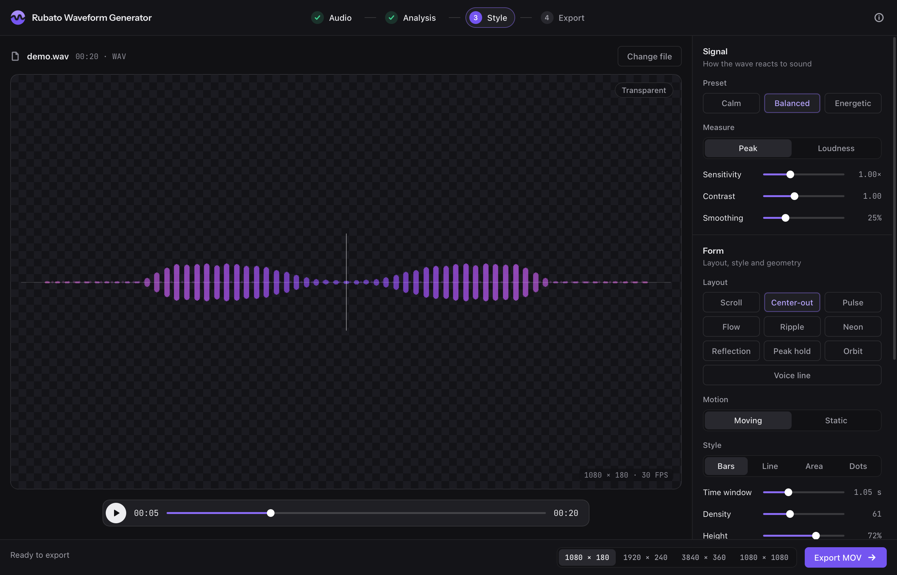

1. Open the app and drop an audio file onto the window, or press Cmd/Ctrl+O.
2. Press Space to play and check the live preview. You can scrub through the audio.
3. Pick a layout, a style and a color theme. Start from the Calm, Balanced or Energetic preset and adjust the sliders.
4. Choose an export size, then press Cmd/Ctrl+E and pick where to save the MOV. You can cancel an export at any time; an existing file is never damaged.
5. Import the MOV into your editor and place it on a track above your footage.

## Layouts

Ten layouts, each shown here on synthetic audio.

| | | |
| --- | --- | --- |
| 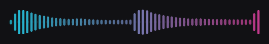<br>**Scroll**: the history of the audio travels sideways. | 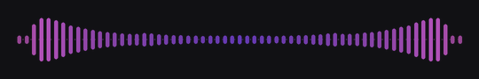<br>**Center-out**: the present sits in the center and echoes to both sides. | 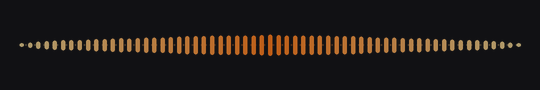<br>**Pulse**: stationary bars pulsing from the center. |
| 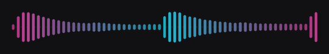<br>**Flow**: like Scroll, with a symmetric gradient. | 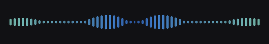<br>**Ripple**: stationary bars pulsing as a wave from the center. | 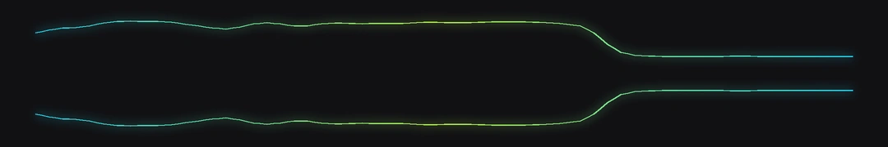<br>**Neon**: a glowing line oscillating around the center, driven by frequency bands. |
| 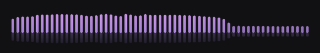<br>**Reflection**: bars above a baseline with a mirrored reflection below, driven by frequency bands. | 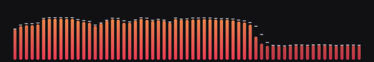<br>**Peak hold**: bars from the bottom with a peak-hold cap, driven by frequency bands. | 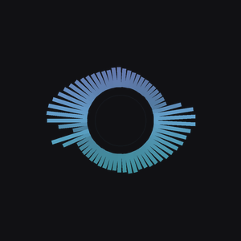<br>**Orbit**: spokes rotating around the center of a square frame. |
| 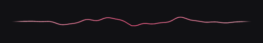<br>**Voice line**: a thin, calm, oscilloscope-like line shaped by the loudness and timbre of a voice. | | |

## Features

- 10 layouts: Scroll, Center-out, Pulse, Flow, Ripple, Neon, Reflection, Peak hold, Orbit, Voice line.
- 4 styles on most layouts: Bars, Line, Area, Dots.
- 18 color themes, solid or gradient fill, and custom colors.
- 3 presets (Calm, Balanced, Energetic) and sliders for Sensitivity, Contrast, Smoothing, Time window, Density, Height and Opacity. Voice line adds Reactivity, Drift and Thickness.
- Moving or Static motion on Scroll, Center-out, Flow and Orbit. Peak or Loudness measure.
- Export sizes 1080×180, 1920×240, 3840×360 and 1080×1080 at 30 fps. Orbit needs a square frame, and the app switches to it automatically. The command line accepts custom sizes and frame rates.
- Real audio analysis every 5 ms. A frequency spectrum (48 bands, 45 Hz to 10 kHz) drives Neon, Reflection, Peak hold and Voice line.
- Live preview with synchronized audio playback, scrubbing, drag and drop, keyboard shortcuts (Space, Cmd/Ctrl+O, Cmd/Ctrl+E) and remembered settings.
- Cancelable export that never damages an existing file.
- Fast analysis: a one-hour WAV took about 6 seconds on an Apple Silicon Mac.
- Fully local. Fonts are bundled, and the interface can only talk to the app's own local server.

## Using the clip in your editor

Place the exported MOV on a track above your footage. The clip carries an alpha channel, so everything except the waveform is transparent.

- **DaVinci Resolve:** verified. It is the author's regular workflow.
- **Premiere Pro, Final Cut Pro, After Effects and others:** not tested by the author. They can generally read ProRes 4444 with alpha, so they are expected to work. Reports are welcome in the [issue tracker](https://github.com/VukoP/rubato-waveform-generator/issues).

The alpha is premultiplied. If edges look wrong in your editor, check that the clip's alpha is interpreted as premultiplied.

## Command line

The `rubato-waveform` command renders without the window. It is installed with the package (see [Build from source](#build-from-source)), and `python -m rubato_waveform` works too.

```sh
rubato-waveform [options] audio output.mov
```

```sh
# A default waveform from a podcast episode
rubato-waveform episode.wav waveform.mov

# A wide Center-out strip in the Cyan theme, at 1920x240
rubato-waveform episode.wav waveform.mov --layout mirror --theme Cyan --width 1920 --height 240

# A square Orbit clip with a solid custom color
rubato-waveform song.mp3 orbit.mov --layout radial --width 1080 --height 1080 --color "#FF5C8A" --no-gradient
```

The output must end in `.mov`. Theme names are the English names listed in the app: Violet, Lavender, Magenta, Pink, Red, Crimson, Ruby, Burgundy, Coral, Orange, Gold, Lime, Green, Mint, Cyan, Blue, White, Graphite. Matching ignores case. Layout names on the command line are the keys `scroll`, `mirror` (Center-out), `pulse`, `flow`, `ripple`, `mirror-reflect` (Reflection), `peakhold`, `neon`, `radial` (Orbit) and `voiceline`.

| Flag | Range or values | Default | Meaning |
| --- | --- | --- | --- |
| `audio` | file path | required | Input audio, or the audio track of a video file. |
| `output` | file path | required | Output transparent MOV. |
| `-h`, `--help` | | | Show help and exit. |
| `--version` | | | Show the version and exit. |
| `--width` | 16-8192 | 1080 | Width in pixels. |
| `--height` | 16-8192 | 180 | Height in pixels. |
| `--fps` | 1-120 | 30 | Frames per second. |
| `--bars` | 8-240 | 61 | Number of bars. 45-90 is recommended. |
| `--style` | `bars`, `line`, `area`, `dots` | `bars` | Drawing style. |
| `--layout` | `scroll`, `mirror`, `pulse`, `flow`, `ripple`, `mirror-reflect`, `peakhold`, `neon`, `radial`, `voiceline` | `scroll` | Layout. |
| `--stationary` | switch | off | For scroll, mirror, flow and radial: bars stay in place and pulse to the current audio instead of travelling sideways. |
| `--metric` | `peak`, `rms` | `peak` | `peak` follows true peaks, as in a DAW. `rms` follows loudness. |
| `--window-seconds` | 0.2-6 | 1.05 | Seconds of audio across the width of the strip. |
| `--sensitivity` | 0.3-2.5 | 1.0 | Sensitivity. |
| `--contrast` | 0.4-2 | 1.0 | Values below 1 emphasize quiet parts. |
| `--smoothing` | 0-1 | 0.25 | 0 is raw, 1 is very smooth. |
| `--theme` | theme name | none | Applies a theme's colors, with its gradient. Without it the color is `#8B4DFF`, solid. |
| `--color` | `#RRGGBB` | none | Primary color. Overrides the theme's first color. |
| `--color2` | `#RRGGBB` | none | Second gradient color. Overrides the theme's second color. |
| `--no-gradient` | switch | off | Always a solid color. Drops the second color even when `--theme` or `--color2` is given. `--color` still sets the solid color. |
| `--opacity` | 1-255 | 235 | Opacity. |
| `--max-height` | 0.15-0.98 | 0.72 | Tallest bar as a fraction of the height. |
| `--no-dots` | switch | off | No dots on the baseline. |
| `--reactivity` | 0-1 | 0.7 | Voice line only. 0 follows loudness only, 1 takes the shape fully from the audio. |
| `--drift` | 0-2 | 1.0 | Voice line only. Wave drift speed. |
| `--line-width` | 1-6 | 2.0 | Voice line only. Line thickness in pixels at 1080×180. |

Exit code 0 means success, 1 means an error such as missing FFmpeg, and 130 means the render was interrupted.

## Build from source

You only need this to change the code or to make your own copy of the app. To just use it, [download it](#download-and-install).

Pick your system and copy the commands. Everything the app needs goes into a `.venv` folder inside the project, so the rest of your computer stays as it was. To remove it all, delete the project folder.

### Build on macOS

Open Terminal and install the tools once, using [Homebrew](https://brew.sh):

```sh
brew install ffmpeg python@3.14
```

**Run the app from source.** The first time takes a little longer while the dependencies download.

```sh
git clone https://github.com/VukoP/rubato-waveform-generator.git
cd rubato-waveform-generator
python3.14 -m venv .venv
source .venv/bin/activate
pip install -e ".[gui]"
python -m rubato_waveform.app
```

To start it again later, open Terminal in the project folder and run:

```sh
source .venv/bin/activate
python -m rubato_waveform.app
```

**Build your own app (optional).** Close the app, then run this in the same Terminal window:

```sh
pip install -r requirements-dev.txt
./packaging/build_macos.sh
```

You get `dist/Rubato Waveform Generator.app`, plus a zip of it to share. A copy built this way runs on your version of macOS or newer, and on another Mac it needs the same Open Anyway step as a download. Release builds come from CI.

### Build on Windows

Open Command Prompt (search for `cmd` in the Start menu). Use Command Prompt rather than PowerShell, which blocks these scripts by default. Install the tools once:

```bat
winget install Git.Git
winget install Python.Python.3.13
winget install Gyan.FFmpeg
```

Then close the window and open a new one, so Windows finds the new tools. Python 3.13 is the version CI uses on Windows.

**Run the app from source.** The first time takes a little longer while the dependencies download.

```bat
git clone https://github.com/VukoP/rubato-waveform-generator.git
cd rubato-waveform-generator
py -3.13 -m venv .venv
.venv\Scripts\activate
pip install -e ".[gui]"
python -m rubato_waveform.app
```

To start it again later, open Command Prompt in the project folder and run:

```bat
.venv\Scripts\activate
python -m rubato_waveform.app
```

**Build your own app (optional).** Close the app, then run this in the same window. The `-ExecutionPolicy Bypass` part lets this one script run and changes nothing on your system.

```bat
pip install -r requirements-dev.txt
powershell -ExecutionPolicy Bypass -File packaging\build_windows.ps1
```

You get `dist\Rubato Waveform Generator\Rubato Waveform Generator.exe`, plus a zip of that folder to share.

The author has not run these Windows steps by hand yet. If a step fails, please [open an issue](https://github.com/VukoP/rubato-waveform-generator/issues).

### Build on Linux

Install Git, FFmpeg and Python 3.12 or newer with your package manager. Debian and Ubuntu also need `python3-venv`. Then get the command line tool:

```sh
git clone https://github.com/VukoP/rubato-waveform-generator.git
cd rubato-waveform-generator
python3 -m venv .venv
source .venv/bin/activate
pip install -e .
rubato-waveform input.wav output.mov
```

For the app window, install the GTK or Qt backend (`pip install -e ".[gui]" "pywebview[gtk]"` or `pip install -e ".[gui]" "pywebview[qt]"`) and the system packages from the [pywebview installation guide](https://pywebview.flowrl.com/guide/installation.html). Then run `python -m rubato_waveform.app`. There is no packaging script for Linux yet.

### Shortcuts and tests

While `.venv` is active, `rubato-waveform-app` opens the app and `rubato-waveform input.wav output.mov` renders without a window (see [Command line](#command-line)). To run the tests or contribute, see [CONTRIBUTING.md](CONTRIBUTING.md).

## FAQ

### How do I add an audio waveform to a video?

Export a transparent waveform clip from this app, then place it on a track above your video in your editor. Drop your audio into the app, pick a layout and theme, export the MOV, and import it like any other clip. See [Quick start](#quick-start).

### How do I make a waveform video with a transparent background?

Export from this app: every clip is ProRes 4444 with an alpha channel in a MOV, so the background is transparent by default. There is no green screen to key out.

### How do I add a podcast waveform in DaVinci Resolve?

Export a clip, import the MOV into the Media Pool, and drag it onto a video track above your episode's artwork or footage. DaVinci Resolve is the editor the author uses and has verified. Voice line is the layout shaped by the loudness and timbre of a voice.

### Is this an audiogram generator?

Partly. It makes the animated waveform layer, which is the core of an audiogram, but it does not add captions, artwork, branding or platform-specific sizes. You combine the transparent clip with those in your editor.

### Is it free, and can I use it commercially?

Yes. The code is free under the Apache-2.0 licence, which allows commercial use. The Rubato and Rubato Studio names and logos are not covered by the licence. See [Licence](#licence).

### Does it upload my audio?

No. Analysis, preview and export all run on your computer. There is no account, no telemetry and the app makes no web requests on its own: fonts are bundled, and the interface can only connect to the app's own local server.

### Why does it need FFmpeg?

FFmpeg decodes your audio and encodes the ProRes 4444 video. It is not bundled, for licensing reasons, so you install it once. The app searches for it automatically and shows install commands when it is missing.

### Why does macOS say the app can't be opened?

The macOS build is ad-hoc signed but not notarized. Try to open it once, then open System Settings > Privacy & Security and choose Open Anyway. See [Download and install](#download-and-install) for the Terminal alternative.

### Why do edges look dark or bright in my editor?

The clip's alpha is premultiplied, and your editor may be reading it as straight alpha. Make sure the clip's alpha is interpreted as premultiplied.

### Can I use it from the command line?

Yes. The `rubato-waveform` command takes an audio file and an output `.mov`, with flags for layout, style, theme, size and more. See [Command line](#command-line).

### Which audio formats does it support?

WAV, MP3, M4A, AAC, FLAC, AIFF, OGG, OPUS, WMA, MKA and CAF, plus the audio track of MP4, MOV, M4V, MKV and WebM files.

## Contributing

Bug reports, ideas and pull requests are welcome. Read [CONTRIBUTING.md](CONTRIBUTING.md) first. Report security problems privately as described in [SECURITY.md](SECURITY.md).

## Support the project

Rubato Waveform Generator is free. If it is useful to you, you can support its development on [Ko-fi](https://ko-fi.com/vukop).

## Licence

Licensed under the [Apache License 2.0](LICENSE). Copyright 2026 VukoP. See [NOTICE](NOTICE).

The Rubato and Rubato Studio names and the Rubato logos are not licensed under Apache-2.0. The logo files are `assets/brand/`, `rubato_waveform/ui/brand/`, `docs/assets/favicon.*` and `docs/assets/social-preview.png`. Forks must replace them and must not use the name to identify their product, except as needed to describe the origin of the work and to reproduce the [NOTICE](NOTICE) file. The script `scripts/make_brand.py` that generates them is ordinary Apache-2.0 code; what is reserved is its output.

The bundled interface fonts, Instrument Sans and JetBrains Mono, are under the SIL Open Font License; their licence texts are in `rubato_waveform/ui/fonts/`. FFmpeg is not bundled and is installed separately under its own licence.

Made by the author of [Rubato Studio](https://rubatostudio.com).
